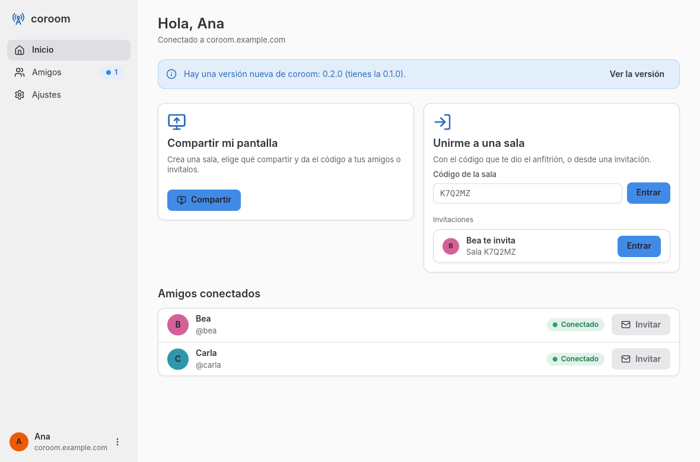
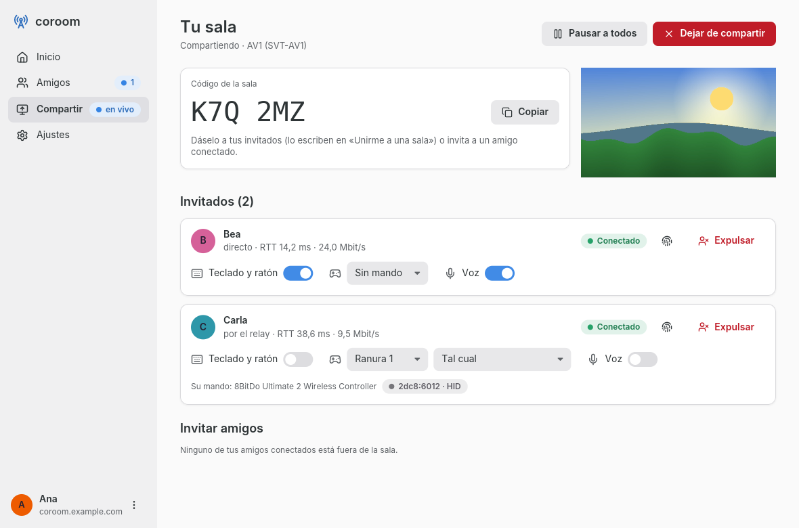
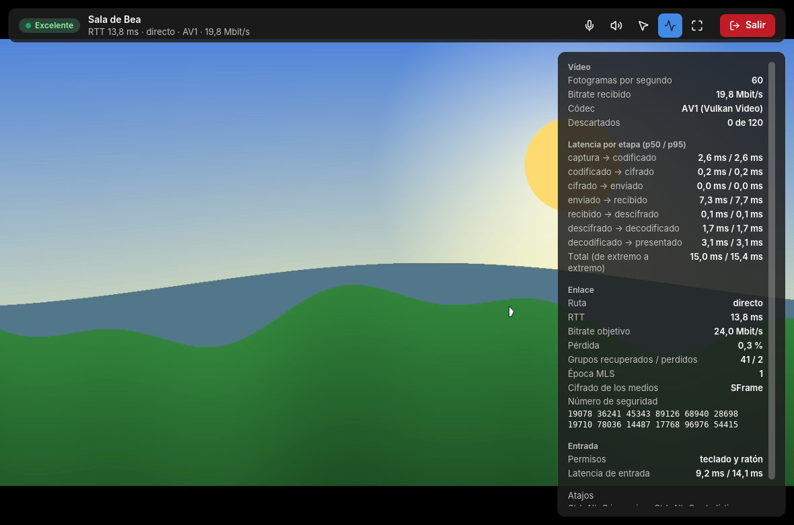
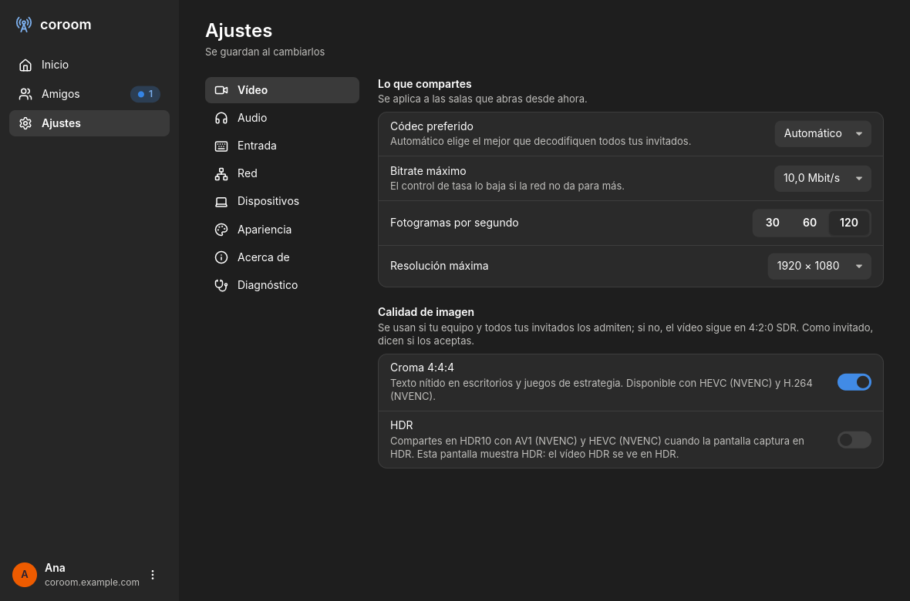

# coroom

Juego remoto con amigos, al estilo de Parsec: un anfitrión comparte su juego y los invitados lo
juegan desde su equipo con la menor latencia posible. Cliente de escritorio en Rust para Linux
(Wayland) y Windows y servidor autoalojado en Rust con HTTP/3, WebTransport y relay QUIC. Todo el
contenido va cifrado de extremo a extremo con MLS, SFrame y HPKE: el servidor no puede verlo.

| Inicio | Sala abierta |
| --- | --- |
|  |  |
| **Invitado, con las estadísticas** | **Ajustes de vídeo** |
|  |  |

Las capturas salen de `cargo test -p coroom --test shots` (con datos ficticios) y son también las
de la ficha de AppStream del Flatpak.

## Estado

**Versión 1.0.0** (protocolo 9). Lo que incluye está en el [`CHANGELOG.md`](CHANGELOG.md); lo que
está implementado y probado en la CI pero falta validar en hardware real (GPU reales, Windows real,
dos NAT distintas, pantallas HDR y de 120 Hz), en [`docs/ARQUITECTURA.md`](docs/ARQUITECTURA.md) §7.

- **Juego remoto con amigos**: vídeo del anfitrión a 1080p60 por defecto (hasta 4K y 120 fps, 4:4:4
  y HDR10 cuando todos lo admiten) con AV1, HEVC o H.264 por hardware y sin copias a CPU (Vulkan
  Video, NVENC, AMF, QSV, VA-API), audio del juego sincronizado con el vídeo y voz opcional.
- **Entrada del invitado**: teclado, ratón (escritorio o inmersivo) y hasta 8 mandos, con permisos
  por invitado y cada mando **tal cual** (su VID/PID y su descriptor HID: Steam y los juegos lo
  ven como ese mando) o convertido a Xbox 360; libei, uinput y UHID en Linux, `SendInput` y un
  driver de mandos propio en Windows.
- **Conexión** QUIC directa entre los equipos cuando la NAT lo permite y, si no, por el relay del
  servidor; control de tasa propio que aguanta pérdida y jitter, FEC y reenvíos.
- **Cifrado de extremo a extremo** con MLS, SFrame y HPKE (X-Wing, poscuántico): el servidor no
  puede ver ni oír nada. Revisión de seguridad en [`docs/seguridad.md`](docs/seguridad.md).
- **Servidor autoalojado** en un binario y un puerto UDP (más TCP de respaldo): cuentas, amigos,
  invitaciones, relay con cuotas y administración web; con tu certificado o uno autofirmado, en
  una LAN, una VPN o fuera. [Guía del operador](deploy/README.md).
- **Aplicación de escritorio** con el tema, el acento y la fuente del sistema, navegable con el
  teclado y con los textos en catálogos Fluent listos para traducir. [Guía de uso](docs/guia.md).

## Documentación

| Documento | Para qué |
|---|---|
| [`docs/guia.md`](docs/guia.md) | Usar coroom: alojar, unirse, permisos, atajos y qué hacer si algo falla |
| [`deploy/README.md`](deploy/README.md) | Montar y mantener el servidor |
| [`docs/seguridad.md`](docs/seguridad.md) | Modelo de amenazas, revisión por capas y hallazgos |
| [`docs/ARQUITECTURA.md`](docs/ARQUITECTURA.md) | Decisiones de la pila, presupuesto de latencia, conexión, estructura y validaciones pendientes |
| [`CONTRIBUTING.md`](CONTRIBUTING.md) | Compilar, probar, estilo y cómo proponer cambios |
| [`CHANGELOG.md`](CHANGELOG.md) | Cambios de cada versión |

| Ruta | Contenido |
|---|---|
| `crates/proto` | Versión del protocolo, ALPN, cabecera de objetos v2 (modelo MoQ), mensajes de control y de señalización, eventos de entrada (`input`), cabecera de audio (`audio`), tipos JSON de la API (`api`); sin IO |
| `crates/crypto` | Identidad Ed25519 (llavero o fichero), credenciales por servidor (`CredentialStore`), número de seguridad, MLS (`RoomGroup`), SFrame (`MediaKeyRing`), HPKE con X-Wing, cifrado de la entrada (`InputCipher`) |
| `crates/transport` | `Endpoint` QUIC (un socket), medios con FEC + NACK, control de tasa, `Connector` (NAT y relay), cliente de señalización, cliente de la API (`ApiClient`, HTTP/3 con respaldo HTTP/2) |
| `crates/capture` | Trait `Capturer`; backends sintético, `pipewire` (Linux) y `wgc` (Windows) |
| `crates/codec` | Traits `Encoder`/`Decoder`; espacio de color y formato (`color`: BT.709, BT.2020 PQ, 4:2:0/4:4:4), BGRA → I420/NV12/I444/NV24 (`yuv`) y → P010 HDR10, OpenH264, FFmpeg (`rsmpeg`), sondeo de capacidades, importación de imágenes de GPU y slices |
| `crates/render` | Trait `Presenter`; dispositivo `wgpu` compartido con Vulkan Video (`GpuContext`), capa de vídeo para la interfaz (`VideoLayer`, I420/NV12/I444/P010 con la matriz y la transferencia del flujo), salida HDR (`hdr`), importación sin copias, presentador offscreen y nulo |
| `crates/ui` | Sistema de diseño `coroom-ui` para `iced`: tokens, tema (paleta Adwaita, acento, contraste AA), fuentes, iconos Lucide y componentes |
| `crates/session` | Trait `Session`; marcas por etapa (`latency`), pipeline local, `LocalSession` y `RemoteSession` |
| `crates/input` | Captura en el invitado (`InputCapture`, mandos con `gilrs`, `InputSender`, guiones JSON), trait `InputSink` con libei + uinput (Linux), `SendInput` y el cliente del driver de mando virtual (Windows) y `RecordingSink`; tabla de teclas evdev ↔ *scancode* |
| `crates/audio` | Traits `AudioSource` y `AudioSink`; PipeWire (Linux), WASAPI (Windows) y sintéticos; Opus (`codec`), buffer de jitter, mezcla, procesado de voz y VAD, sincronía A/V |
| `apps/desktop` | Binario `coroom`: la aplicación (`ui`, sin argumentos) y `doctor`, `probe`, `host`, `join`, `login`, `logout`, `whoami`, `friends` e `invite` |
| `apps/server` | Binario `coroom-server`: HTTP/3, señalización WebTransport y relay en un puerto UDP; HTTP/2 con TLS por TCP; cuentas en SQLite, `/admin`; `backup`, `admin reset-password`, `migrate` |
| `deploy/` | Dockerfile (multi-arquitectura), `docker-compose.yml`, `.env.sample` y [guía de despliegue](deploy/README.md) |
| `packaging/` | Flatpak (`flatpak/`: manifiesto, `cargo-sources.json`, AppStream y `.desktop`), MSIX (`msix/`: `AppxManifest.xml`, iconos y `build.ps1`) e icono propio (`icons/coroom.svg`) |
| `vendor/` | `iced_wgpu` y `cryoglyph` adaptados a `wgpu` 30 hasta que `iced` publique esa versión ([por qué](vendor/README.md)) |
| `fuzz/` | Objetivos de fuzzing con `cargo-fuzz` (workspace aparte, nightly) y sus semillas ([formatos](fuzz/README.md)) |
| `apps/desktop/locales/` | Catálogos Fluent de los textos de la aplicación (`es` completo) |

## Instalar

Las publicaciones están en <https://github.com/43fdfdg45454/coroom/releases>; cada una trae el
Flatpak, el MSIX y el `.zip` de Windows, el driver de mando virtual de Windows
(`coroomvhid-*-x64.zip` y `-ARM64.zip`, firmado en la CI; se instala con su `install.ps1`) y
`SHA256SUMS`, y sube la imagen del servidor a GHCR. La aplicación avisa en Inicio cuando hay una versión nueva
(una consulta al día a la API pública de GitHub, sin token ni datos tuyos; se desactiva en Ajustes
→ Acerca de o con `COROOM_NO_UPDATE_CHECK=1`).

### Linux: Flatpak

```bash
flatpak install --user flathub org.freedesktop.Platform//26.08   # el runtime, si no lo tienes
flatpak install --user coroom-X.Y.Z-x86_64.flatpak
flatpak run io.github._43fdfdg45454.coroom
```

Permisos del paquete (`packaging/flatpak/io.github._43fdfdg45454.coroom.yml`): Wayland (X11 solo de
respaldo), la GPU (`--device=dri`), la red, PipeWire para el audio
(`--filesystem=xdg-run/pipewire-0`) y `--device=all` para los mandos (`/dev/input` y
`/dev/uinput`, y para los mandos tal cual `/dev/hidraw*` en el invitado y `/dev/uhid` en el
anfitrión, que `--device=input` no cubre). La pantalla se comparte
por el portal `ScreenCast` y la entrada del anfitrión por el portal `RemoteDesktop` (los permisos
los da el diálogo del portal); la identidad y las credenciales se guardan selladas con la clave
del portal `Secret`, sin acceso al llavero entero. Los **mandos virtuales** del anfitrión
necesitan además que tu usuario pueda abrir `/dev/uinput` y `/dev/uhid` (las reglas de udev de
«Entrada»), y sin ellas el resto funciona igual. El HDR de la
ventana necesita un compositor con gestión de color de Wayland y Mesa reciente; si no, el vídeo
HDR se ve con *tone mapping*.

### Windows: MSIX o `.zip`

El `.zip` portátil (`coroom-X.Y.Z-windows-x64.zip`) se descomprime y se abre `coroom.exe`; lleva
las DLL de FFmpeg (LGPL, enlace dinámico) y sus licencias.

El MSIX de las publicaciones va firmado con un **certificado de prueba** (`CN=coroom-dev`), así
que antes de instalarlo hay que confiar en él (una vez, en PowerShell como administrador):

```powershell
Import-Certificate -FilePath .\coroom-dev.cer -CertStoreLocation Cert:\LocalMachine\TrustedPeople
Add-AppxPackage .\coroom-X.Y.Z-x64.msix
```

Para generarlo a mano: `.\packaging\msix\build.ps1 -TestCertificate` (compila, copia las DLL de
`third_party\ffmpeg\bin`, crea `dist\coroom-X.Y.Z-x64.msix`, `dist\coroom-X.Y.Z-windows-x64.zip`
y `dist\coroom-dev.cer`; necesita el SDK de Windows por `makeappx` y `signtool`). **Firma real**:
con un certificado de firma de código de una autoridad reconocida (o Azure Trusted Signing),
`.\packaging\msix\build.ps1 -CertificatePath firma.pfx -Publisher "CN=…"`, con el sujeto exacto
del certificado en `-Publisher` (va al manifiesto) y la contraseña en `COROOM_SIGN_PASSWORD`;
firma con sello de tiempo, así el paquete sigue siendo válido cuando caduque el certificado.

### Servidor: Docker

```bash
docker pull ghcr.io/43fdfdg45454/coroom-server:X.Y.Z   # amd64 y arm64
```

`deploy/docker-compose.yml` usa esa imagen con la versión de `COROOM_VERSION`; la guía completa
está en [`deploy/README.md`](deploy/README.md).

## Compilar y probar

Requisitos: Rust estable (lo fija `rust-toolchain.toml`) y un compilador de C para `aws-lc-rs` y
OpenH264 (gcc o clang en Linux; las herramientas de compilación de MSVC y NASM en Windows). En
Linux, además:

```bash
sudo apt-get install -y libpipewire-0.3-dev libclang-dev pkg-config libxkbcommon-dev libwayland-dev mesa-vulkan-drivers libudev-dev cmake meson ninja-build
tools/fetch-meson-wraps.sh
```

(`libudev-dev` lo pide `gilrs`, que lee los mandos del invitado. `cmake` compila la libopus que
trae `opusic-sys` y `meson` + `ninja` el módulo de procesado de voz de WebRTC
(`webrtc-audio-processing`); `tools/fetch-meson-wraps.sh` deja en `third_party/meson-packagecache/`
el abseil-cpp que necesita, con sus SHA-256 fijados, para que meson no descargue nada al compilar.
En Windows basta CMake, que trae Visual Studio: allí el procesado de voz es el respaldo propio.)

Versiones mínimas comprobadas: **libpipewire 1.0.4** (la captura de audio usa `pw_stream_get_nsec`,
que apareció en esa versión; Debian 12 trae 0.3.65 y necesita el paquete de *backports*) y
**meson 1.3** (el 1.0.1 de Debian 12 falla al reconfigurar el módulo de WebRTC; Ubuntu 24.04 y
Fedora traen versiones válidas).

### FFmpeg

`coroom-codec` enlaza **FFmpeg 8 compartido (LGPL, sin componentes GPL)** con `rsmpeg`. La build
de desarrollo y de la CI es la de [BtbN](https://github.com/BtbN/FFmpeg-Builds) fijada en
[`tools/ffmpeg.lock`](tools/ffmpeg.lock) (etiqueta del release, nombre y SHA-256 de los ficheros de
Linux y Windows). Para descargarla en `third_party/ffmpeg/` (fuera de git):

```bash
tools/fetch-ffmpeg.sh          # Linux: descarga, comprueba el SHA-256 y lista los codificadores
tools\fetch-ffmpeg.ps1         # Windows (PowerShell)
tools/fetch-ffmpeg.sh --pin    # fija en el lock el autobuild más reciente de BtbN (o --pin ETIQUETA)
```

`rusty_ffmpeg` (el binding de bajo nivel de `rsmpeg`) lee al compilar `FFMPEG_INCLUDE_DIR`,
`FFMPEG_LIBS_DIR` y `FFMPEG_LINK_MODE`; [`.cargo/config.toml`](.cargo/config.toml) las apunta a
`third_party/ffmpeg/`. Para usar otra build de FFmpeg ≥ 8.0 (la del sistema, una compilada a
mano), exporta las dos primeras, que tienen prioridad:

```bash
export FFMPEG_INCLUDE_DIR=/ruta/a/ffmpeg/include FFMPEG_LIBS_DIR=/ruta/a/ffmpeg/lib
```

Sin FFmpeg, `cargo build` se para con un mensaje que dice qué ejecutar. En Linux los binarios y los
tests llevan `rpath` al directorio de las bibliotecas (solo desarrollo; Flatpak y MSIX llevan su
propio FFmpeg); en Windows las DLL se copian junto a los ejecutables de
`target/<perfil>/` y, para los tests, conviene tener `third_party\ffmpeg\bin` en el `PATH`. El
registro de FFmpeg va callado salvo errores fatales; `COROOM_FFMPEG_LOG=error|warning|info|debug`
lo sube.

```bash
cargo fmt --all --check
cargo clippy --workspace --all-targets -- -D warnings
cargo test --workspace
cargo deny check                     # licencias, avisos de seguridad y orígenes (cargo install cargo-deny)

cargo run -p coroom -- doctor        # sistema, captura, portal, adaptador gráfico y tabla de códecs
cargo run -p coroom-server           # HTTP/3 en UDP 4433 y HTTP/1.1-2 en TCP 8080
curl -i http://localhost:8080/health
```

### La aplicación

```bash
cargo run --release -p coroom                 # abre la aplicación
COROOM_DATA_DIR=/tmp/coroom-b cargo run --release -p coroom   # perfil aparte: ajustes, identidad y sesión en ficheros
```

1. **Servidor**: «Añadir servidor» con la dirección que te dio quien lo administra
   (`https://coroom.example.com`). La aplicación lo comprueba al momento (versión, protocolo, si
   el UDP llega desde tu red) y, si el certificado es autofirmado, enseña su huella para compararla
   con la que imprime el servidor antes de pulsar «Confiar».
2. **Entrar**: usuario, contraseña y nombre de este equipo, o «Tengo un código de invitación» para
   crear la cuenta. La sesión se guarda en el llavero y la próxima vez se entra solo.
3. **Inicio**: «Compartir mi pantalla» abre la sala (elige pantalla o fuente de prueba, audio y
   voz; el código grande se copia con un clic y los amigos conectados se invitan desde ahí);
   «Unirme a una sala» entra con un código o con una invitación recibida.
4. **En la sala**, el invitado ve los pasos de la conexión y la **calidad esperada** (RTT medido
   durante un segundo + 25 ms de pipeline: Excelente ≤ 40 ms, Buena ≤ 70, Aceptable ≤ 110, Mala
   por encima) y después el vídeo. Si se cae la red, reintenta 5 veces (0,5 s, 1 s, 2 s, 4 s y
   8 s) y avisa sin cortar; «Reintentar ya» no espera.

| Atajo | Dónde | Qué hace |
|---|---|---|
| `Ctrl+Q` | siempre | sale (pregunta si estás compartiendo) |
| `Ctrl+,` | siempre | Ajustes |
| `F11` | siempre | pantalla completa |
| `Esc` | siempre | cierra el diálogo o el menú y sale de la pantalla completa; en la sala, pregunta si salir (en el vídeo con teclado permitido, va al juego) |
| `Tab`, `Mayús+Tab` | formularios | siguiente y anterior campo |
| `Ctrl+Alt+G/S/C/M/V/J/Q` | vídeo | inmersivo, estadísticas, chat, micrófono, audio del juego, mandos y salir (las letras se cambian en Ajustes → Mandos) |

«Avanzado» en Compartir explica qué hace este equipo con **4:4:4** y **HDR** (con qué códecs y si la
pantalla muestra HDR; «no disponible con este códec» si el elegido no lo admite) y los dos
interruptores sirven también como invitado: dicen si aceptas recibirlo. Con HDR activado y una
pantalla que lo expone, la ventana pasa a una superficie HDR en caliente. **120 fps** se eligen en
el mismo sitio; la ventana presenta en modo inmediato.

Los ajustes (calidad, audio, atajos, red, apariencia, actualizaciones, servidores recientes y
números de seguridad de los anfitriones) se guardan al cambiarlos en `settings.toml` del directorio
de datos (`COROOM_DATA_DIR`, o `$XDG_DATA_HOME/coroom`, `%APPDATA%\coroom`). Ajustes → Cuenta y
servidor cierra la sesión de otros equipos de tu cuenta, y el diagnóstico (el botón del servidor en
la cabecera, o la píldora de latencia en la sala) explica la ruta de la sala, los candidatos de
conexión directa, la latencia por etapa y lo que dice `coroom doctor`, con «Copiar informe» sin
direcciones ni nombres.

### Prueba de latencia (`coroom probe`)

```bash
cargo run --release -p coroom -- probe                                # ventana con el vídeo y sus estadísticas; Esc para salir
cargo run --release -p coroom -- probe --source screen                # pantalla real (pide permiso al portal en Linux)
cargo run --release -p coroom -- probe --headless --frames 600        # sin ventana: tabla por etapa al terminar
cargo run --release -p coroom -- probe --headless --frames 600 --json # el mismo resumen en JSON
cargo run --release -p coroom -- probe --headless --width 1280 --height 720 --fps 60 --bitrate-kbps 6000
cargo run --release -p coroom -- probe --headless --codec av1 --encoder software    # SVT-AV1 → dav1d
cargo run --release -p coroom -- probe --codec hevc --encoder nvenc --decoder nvdec # hardware concreto
cargo run --release -p coroom -- probe --headless --width 1280 --height 720 --fps 120 --frames 240   # 120 fps
cargo run --release -p coroom -- probe --headless --codec av1 --encoder software --hdr               # HDR10 de extremo a extremo
cargo run --release -p coroom -- probe --codec hevc --encoder nvenc --yuv444                         # 4:4:4
```

`--hdr` pide la captura en coma flotante (la sintética pone el bloque que rebota a 1000 nits),
codifica a 10 bits en BT.2020 PQ (SVT-AV1 por software lo hace en cualquier equipo; HEVC y AV1 por
hardware donde haya; por software es la prueba, no el uso: con 4 núcleos SVT-AV1 a 10 bits no pasa
de unos 26 fps a 720p) y la ventana lo muestra en HDR o con *tone mapping*; `--yuv444` codifica en
4:4:4 (NVENC con H.264 o HEVC, Vulkan Video según el driver; ningún codificador por software).
`coroom host` y `coroom join` tienen las mismas opciones: el formato se usa solo si el anfitrión
lo codifica y todos los invitados lo aceptan.

`--codec` elige `h264` (por defecto), `hevc` o `av1`; `--encoder` (`auto`, `software`, `vulkan`,
`nvenc`, `amf`, `qsv`, `vaapi`) y `--decoder` (`auto`, `software`, `vulkan`, `nvdec`, `d3d12va`,
`d3d11va`, `vaapi`) fuerzan un backend; con `auto` se usa el mejor que pasó el sondeo de
`coroom doctor`. El resumen y el overlay dicen qué códec y qué backends se usaron.

Sin ventana, la tabla muestra para cada tramo (captura → codificado → cifrado → enviado →
recibido → descifrado → decodificado → presentado; en la prueba local no se cifra y esos dos tramos
valen 0) y para el total los percentiles 50, 95 y 99 y el máximo, los descartes
por etapa, los fps y el bitrate real. `coroom probe --help` lista las opciones.

### Cuentas, amigos e invitaciones

Cada jugador tiene una **cuenta** en el servidor y cada equipo se **vincula** a ella
al iniciar sesión: la app presenta la clave pública de su identidad, firma un desafío del servidor
y guarda el token de sesión (30 días) en el llavero del sistema (o, sin llavero, con `--headless` o
`--data-dir`, en `servers/<host>.json` del directorio de datos). El servidor solo abre la
señalización y el relay a dispositivos vinculados. Montar el servidor y crear el administrador:
[guía de despliegue](deploy/README.md).

```bash
# Con un código de invitación del administrador: elige tu nombre y tu contraseña.
coroom login --server https://coroom.example.com --invitation XXXX-XXXX-XXXX
# Con una cuenta que ya existe (pide usuario y contraseña sin eco).
coroom login --server https://coroom.example.com
coroom whoami                  # cuenta, dispositivo y uso del relay este mes
coroom friends add bea         # solicitud de amistad (si ya te la pidió, sois amigos)
coroom friends accept ana      # aceptar la de ana
coroom friends list            # ● conectado ○ desconectado, y solicitudes pendientes
coroom friends remove bea
coroom logout
```

`--server` solo hace falta la primera vez (después se usa el último servidor). Para no pedir la
contraseña por la consola (guiones), `--user NOMBRE --password-stdin`.

**Invitar a una sala**: el anfitrión invita a amigos conectados con `coroom host --invite bea`
(se puede repetir), con la orden `invite bea` de su consola o desde otro terminal con
`coroom invite bea --code ABC234`. El amigo, con `coroom join` **sin código**, ve las invitaciones
que le llegan («Ana te invita a la sala ABC234») y elige una (`--first` entra con la primera). El
código de la sala sigue sirviendo para entrar sin ser amigos.

### Sesión remota entre dos máquinas (`coroom host` y `coroom join`)

Hacen falta el servidor (con UDP 443 abierto; ver la [guía de despliegue](deploy/README.md)), el
anfitrión y el invitado, cada uno con su cuenta y la sesión iniciada (`coroom login`).

1. **Anfitrión**: crea la sala e imprime su código, su huella y, cuando entra cada invitado, su
   nombre, su huella y el número de seguridad (entran aprobados con permisos de solo mirar):

   ```bash
   cargo run --release -p coroom -- host --source screen     # o --source synthetic
   ```

2. **Invitado**, en la otra máquina, con el código de la sala (o sin él, para esperar la
   invitación): abre la ventana de vídeo con el overlay (anfitrión, ruta directo/relay, RTT,
   bitrate objetivo, pérdida, época MLS y número de seguridad, que debe coincidir con el que ve el
   anfitrión):

   ```bash
   cargo run --release -p coroom -- join ABC234
   ```

   Al abrir la sala y al entrar, coroom pide al router por PCP, NAT-PMP o UPnP que abra su puerto
   UDP y anuncia la dirección WAN del router como candidato (también detrás de la NAT de la
   operadora, entre clientes de la misma); `--no-port-mapping` lo evita y `coroom doctor` dice qué
   respondió el router. Para probar el relay, `--force-relay` en el invitado (o en los dos). Sin ventana,
   `--headless --frames 600 [--json]` imprime al terminar el desglose por etapa y el resumen del
   enlace. `--data-dir` cambia dónde se guardan la identidad y las credenciales (sin él, el
   llavero del sistema, o `~/.local/share/coroom` sin llavero o con `--headless`); si se prueban
   anfitrión e invitado en la misma máquina, cada uno necesita su `--data-dir` y su cuenta.

**Servidor de desarrollo** (sin certificado): `COROOM_TLS_MODE=self-signed cargo run --release -p
coroom-server` imprime `fingerprint=<64 caracteres hex>`, la huella del certificado autofirmado;
los clientes la fijan con `--trust-fingerprint <huella>` en `coroom login` (se guarda con la
sesión) y, como el TCP de desarrollo escucha en el 8443, `--tcp-port 8443` para el respaldo
HTTP/2. Con `COROOM_DEV_TOKEN=change-me` en el servidor, `host` y `join` aceptan además
`--dev-token change-me` sin cuenta (solo para desarrollo).

Sin `--trust-fingerprint`, el cliente valida el servidor con las raíces de confianza del sistema
(el certificado del operador emitido por una autoridad en la que confía el equipo). Si el servidor dice que la sala no tiene relay (cuota agotada o
relay deshabilitado), los clientes lo avisan y conectan solo en directo. `coroom host --help` y
`coroom join --help` listan el resto de opciones (`--width`, `--height`, `--fps`,
`--bitrate-kbps`, `--invite`…).

**Códec**: el invitado anuncia lo que decodifica al conectar y el anfitrión elige el mejor códec
común (primero lo acelerado por hardware; a igualdad, AV1 → HEVC → H.264), lo imprime
(`Vídeo en AV1 (codifica SVT-AV1).`) y, si entra un invitado que no lo decodifica, baja al
siguiente común para todos. `coroom host --codec av1|hevc|h264` fuerza un códec (por defecto
`auto`) y `--encoder` un backend; `coroom join --decoder` fuerza el backend de decodificación.

### Entrada: teclado, ratón y mandos

Los invitados entran con permisos de **solo mirar**. El anfitrión los cambia mientras la sala
corre escribiendo órdenes en la consola de `coroom host` (`help` las lista):

| Orden | Qué hace |
|---|---|
| `list` | invitados, ruta, permisos, eventos aplicados y descartados y latencia de su entrada |
| `allow N kbm` | teclado y ratón para el invitado N |
| `allow N pad RANURA` | mando virtual en esa ranura (1 a `COROOM_MAX_GAMEPADS`, 4 por defecto, hasta 8) |
| `allow N raw` / `deny N raw` | su mando **tal cual** (por defecto) o convertido a Xbox 360 |
| `deny N kbm\|pad\|voice` | quitar ese permiso (lo pulsado se suelta y el mando se destruye) |
| `pause` / `resume` | pausar o reanudar la entrada de todos (en pausa se suelta todo y se descarta lo que llegue) |
| `kick N` | expulsar (se suelta lo suyo, se libera su ranura y rotan las claves) |
| `say TEXTO` | escribir en el chat de la sala (también en la consola de `coroom join --headless`) |
| `clear-chat` | vaciar el chat para todos |
| `quit` | cerrar la sala |

`--auto-allow kbm,pad` concede teclado y ratón y la primera ranura libre a cada invitado que entra
(para probar). El invitado solo envía lo que tiene permitido, y el anfitrión descarta y cuenta lo
demás antes de inyectar. Toda la entrada va cifrada con la clave pareja a pareja (AES-256-GCM
derivada del secreto HPKE): ni el relay ni otro invitado pueden leerla ni falsificarla.

**En la ventana del invitado** (`coroom join`):

| Atajo | Qué hace |
|---|---|
| `Ctrl+Alt+G` | alterna el **modo escritorio** (cursor libre, posición absoluta) y el **modo inmersivo** (cursor capturado y oculto, movimiento relativo, para juegos en primera persona) |
| `Ctrl+Alt+S` | muestra u oculta el panel de estadísticas |
| `Ctrl+Alt+C` | abre o cierra el chat de la sala |
| `Ctrl+Alt+M` / `Ctrl+Alt+V` | silencia o reactiva el micrófono / el audio del juego |
| `Ctrl+Alt+J` | panel de mandos: cuál envías (automático o uno concreto) |
| `Ctrl+Alt+Q` | sale (con teclado y ratón permitidos, `Esc` va al juego) |

Al perder el foco se suelta todo lo pulsado y el cursor. En modo inmersivo, si el cursor se
suelta, un clic en la ventana lo vuelve a capturar. El overlay dice qué permite el anfitrión
("solo mirar", "teclado y ratón", "mando en ranura 2") y la latencia de entrada que mide el
anfitrión. Las letras se cambian en Ajustes → Mandos.

**Mandos tal cual.** Con varios mandos conectados, el invitado elige en el panel de mandos cuál
envía: **Automático** (el último que conectes; si lo desconectas, el siguiente) o uno concreto,
que se recuerda entre sesiones. Conectarlos y desconectarlos en plena sesión funciona sin más. El
anfitrión decide por invitado si su mando llega **tal cual** (por defecto) o **convertido a Xbox
360**, y ve cuál es («Su mando: 8BitDo Ultimate 2 · 2dc8:6012 · HID»). Tal cual, el anfitrión
crea un mando con el mismo VID/PID, nombre y descriptor HID que el físico, y le pasan sus informes
sin traducir: Steam, SDL y el juego lo reconocen como ese mando, con sus botones extra, giroscopio
o lo que declare, y la vibración y las luces vuelven al mando del invitado. Un mando de Xbox por
cable (XInput, sin HID en crudo) llega con su identidad. Funciona con anfitrión e invitado en
Linux o Windows. Si no se puede (sin acceso a `/dev/hidraw*` o `/dev/uhid` en Linux, sin el
driver de coroom en un anfitrión Windows, o un descriptor que también declara teclado o ratón sin
ese permiso), va convertido y la tarjeta del invitado dice por qué. En el invitado Linux, leer el
mando en crudo necesita acceso a su `/dev/hidraw*`: las reglas de Steam (`steam-devices`) cubren la
mayoría; si no, una para tu mando (`KERNEL=="hidraw*", ATTRS{idVendor}=="2dc8", TAG+="uaccess"`).
En el invitado Windows no hace falta nada (si Steam está abierto, puede cambiar el modo de algunos
mandos: mejor cerrarlo).

**Anfitrión en Linux**:

- Teclado y ratón por **libei** a través del portal `RemoteDesktop` (xdg-desktop-portal 1.17 o
  posterior y un escritorio que implemente `ConnectToEIS`; `coroom doctor` dice qué versión del
  portal hay y si `/dev/uinput` es accesible). Con `--source screen` la captura y la entrada comparten
  **un solo diálogo del portal** (una sesión `RemoteDesktop` + `ScreenCast`); con
  `--source synthetic` el diálogo de control remoto sale al conceder teclado y ratón por primera
  vez.
- Mandos por **uinput**: un "coroom Gamepad N" por ranura, visto por SDL, Steam y los juegos como
  un mando de Xbox 360. Hace falta acceso a `/dev/uinput`; la regla udev (una vez):

  ```bash
  echo 'KERNEL=="uinput", SUBSYSTEM=="misc", TAG+="uaccess", OPTIONS+="static_node=uinput"' \
      | sudo tee /etc/udev/rules.d/60-coroom-uinput.rules
  sudo udevadm control --reload && sudo udevadm trigger
  ```

  y volver a entrar en la sesión. En Flatpak hace falta la misma regla (el paquete ya pide
  `--device=all`). Sin acceso, `allow N pad` avisa con esta misma regla.
- Mandos **tal cual** por **UHID** (`/dev/uhid`): el mando del invitado con su VID/PID y su
  descriptor, que el kernel trata como si estuviera enchufado (`hid-generic`, `hid-playstation`,
  `hid-nintendo`… según el VID/PID). La regla udev (una vez):

  ```bash
  echo 'KERNEL=="uhid", SUBSYSTEM=="misc", TAG+="uaccess", OPTIONS+="static_node=uhid"' \
      | sudo tee /etc/udev/rules.d/60-coroom-uhid.rules
  sudo udevadm control --reload && sudo udevadm trigger
  ```

  Sin ella, el mando va convertido y la tarjeta del invitado lo explica.

**Anfitrión en Windows**: teclado y ratón por `SendInput` (tecla física por *scancode*; ratón
relativo sin agrupar y absoluto sobre el monitor principal). **Mandos con el driver de coroom**:
Windows no tiene API de usuario para crear un mando, así que hace falta instalar una vez el driver
de [`drivers/windows-vhid/`](drivers/windows-vhid/README.md): un driver de modo usuario (UMDF2)
que se instala con `install.ps1` desde el paquete de cada versión, sin firma de prueba y con el
arranque seguro y la integridad de memoria activados (ahí están la compilación, la firma, la
instalación, la desinstalación y la solución de problemas). Con él, cada ranura
(`allow N pad RANURA`) es un mando de Xbox 360 (los cuatro primeros; que ven todos los juegos,
también los que solo usan XInput) o, tal cual, el mando del invitado con su VID/PID y su
descriptor, que Steam y SDL reconocen como ese mando; `coroom doctor` dice si está instalado. Sin
el driver, o con
`coroom host --gamepad-to-keys`, los mandos se convierten en teclas con un perfil fijo: stick
izquierdo → W A S D, cruceta → flechas, A → Espacio, B → E, X → R, Y → F, LB → Q, RB → Tab,
LT → Mayús, RT → Ctrl, Back → Esc, Start → Intro (todos los mandos escriben en el mismo teclado).

**Probar con un juego cooperativo local** (hasta 4 invitados con mando):
con el servidor de la sección anterior, en el anfitrión

```bash
cargo run --release -p coroom -- host --server https://coroom.example.com:4433 \
    --trust-fingerprint <huella> --source screen
```

y en cada invitado `coroom join … CÓDIGO` con su mando conectado. En la consola del anfitrión,
`list` y `allow 1 pad 1`, `allow 2 pad 2`… (o `--auto-allow pad`). Abre en el anfitrión un juego
con multijugador local para mandos (cualquiera que use SDL o Steam Input) y comprueba que ve un
mando por invitado y que cada uno mueve a su jugador; `pause` debe soltar todo y `kick N` quitar su
mando. Anota en un issue el escritorio, el juego y `list` al terminar.

Para pruebas sin ventana, `coroom join --headless --input-script guion.json` reproduce un guion de
entrada (formato en `crates/input/src/script.rs`; por ejemplo `mouse_moves` a 1000 Hz) y termina
con él.

### Audio y voz

**Anfitrión** (`coroom host`):

| Opción | Qué hace |
|---|---|
| `--audio system` | por defecto: lo que suena en la salida del sistema (monitor del *sink* por defecto en PipeWire, *loopback* en WASAPI) |
| `--audio app NOMBRE` | Linux: solo esa aplicación (su nodo de PipeWire, por `application.name`, el ejecutable o `node.name`; vale un trozo) |
| `--audio process PID` | Windows: solo ese proceso y sus hijos (**loopback por proceso**, Windows 10 20348 o posterior) |
| `--audio apps-except A,B` | todas las aplicaciones que suenan salvo esas claves (el ejecutable en minúsculas en Windows, `discord.exe`; `application.name` en PipeWire); las que empiezan a sonar después entran solas |
| `--audio apps-only A,B` | solo esas aplicaciones |
| `--audio none` | sin audio del juego |
| `--voice [--mic NOMBRE]` | el anfitrión habla por la sala (activación por voz) |
| `--guests-muted` | los invitados entran sin permiso de voz, hasta `allow N voice` |
| `--speaker NOMBRE` | dónde suena la voz de los invitados (por defecto, la salida del sistema) |
| `--audio-frame-ms 20` | paquetes de 20 ms en lugar de 10 si la tasa de paquetes aprieta |

La voz es un permiso más: los invitados entran con él (con `--guests-muted`, sin él) y se cambia
con `allow N voice` / `deny N voice` en la consola. Sin él, el anfitrión descarta la voz del
invitado; oír a la sala no necesita permiso.

**Invitado** (`coroom join`):

| Opción o atajo | Qué hace |
|---|---|
| `--voice` | habla por la sala (activación por voz); el permiso lo trae al entrar, salvo que el anfitrión abra con `--guests-muted` |
| `--ptt TECLA` | pulsar para hablar con esa tecla (`F12`, `CapsLock`, `v`…; no llega al juego) |
| `--mic NOMBRE` / `--speaker NOMBRE` | micrófono y salida por su nombre (por defecto, los del sistema) |
| `--mute-game` | empieza con el audio del juego silenciado |
| `--no-audio` | sin audio |
| `Ctrl+Alt+M` | silencia o reactiva el micrófono |
| `Ctrl+Alt+V` | silencia o reactiva el audio del juego |

El overlay enseña |A−V|, el retardo del juego y el **boca-oído** de la voz, la pérdida, **quién
habla** y el estado del micrófono; el resumen final (`--json` incluido) trae el desglose por etapa
de cada pista (captura, procesado, codificado, cifrado, enviado, recibido, decodificado, suena),
PLC, FEC, DRED, recortes y estiramientos del buffer y el objetivo de jitter. `coroom doctor`
lista los dispositivos (micrófonos, salidas y aplicaciones que suenan) y si hay loopback por
proceso. Los nombres que piden `--mic`, `--speaker` y `--audio app` son los que lista.

**Cómo va**: Opus (libopus 1.6.1) a 48 kHz en tramas de 10 ms; el juego en estéreo a 128 kbit/s
(`restricted low-delay`, 2,5 ms de retardo algorítmico) y la voz en mono a 32 kbit/s (`voip`, DTX,
FEC en banda). **DRED** (la redundancia profunda de Opus 1.5+, 100 ms) solo en **Linux**; en
Windows, la FEC clásica. Cada paquete va en un datagrama propio, cifrado con SFrame con la clave de
su emisor y su marca de captura en el reloj del anfitrión (sin FEC RaptorQ: la redundancia es la de
Opus). Cada emisor tiene su buffer de jitter adaptativo (objetivo = p95 del jitter + una trama,
entre 20 y 60 ms) con PLC, FEC o DRED en las pérdidas, y se mezcla con limitador suave. El audio
del juego se alinea con el vídeo: el invitado compara cada trama con el fotograma de captura más
cercana y estira o recorta el buffer del audio (el vídeo no se retrasa nunca).

**Procesado de voz**: en Linux, el módulo de WebRTC (`webrtc-audio-processing` 2.1: filtro paso
alto, supresión de ruido, AGC2 y **cancelación de eco AEC3** con lo que suena como referencia); en
Windows, un respaldo propio (puerta de ruido y ganancia) **sin AEC**: se asumen auriculares. El
detector de voz es propio en los dos (WebRTC 2.x ya no lo trae). DeepFilterNet no se usa: su crate
no publica desde 2022.

**Sin dispositivos** (`--headless`): fuentes y salidas sintéticas (tonos de 440, 550 y 660 Hz y
salidas que graban), las de los tests de `apps/desktop/tests/audio.rs`.

**Probar en tus dispositivos** (anota el resultado en un issue): con el servidor de «Sesión remota»,
en el anfitrión `coroom host … --voice` y un juego sonando (en Windows, `--audio process PID` con
el PID del juego); en el invitado `coroom join … --voice CÓDIGO` con auriculares, y en la consola
del anfitrión `allow 1 voice`. Comprueba que el overlay del invitado da |A−V| < 40 ms y boca-oído
< 80 ms en la LAN, que `Ctrl+Alt+M` y `Ctrl+Alt+V` silencian, que `--ptt F12` solo habla con la
tecla pulsada, que «habla:» señala a quien habla y, con altavoces en lugar de auriculares en
Linux, que no se oye eco.

### Probar en tu GPU

La ruta sin copias solo se puede comprobar con una GPU real. En la máquina que quieras
probar, con FFmpeg descargado (`tools/fetch-ffmpeg.sh` o `.ps1`):

```bash
cargo run --release -p coroom -- doctor
cargo run --release -p coroom -- probe --source screen --codec av1 --encoder auto --headless --frames 600
cargo run --release -p coroom -- probe --source screen --codec hevc --encoder auto --headless --frames 600
cargo run --release -p coroom -- probe --source screen --codec h264 --encoder auto --headless --frames 600
```

`--source screen` pide permiso al portal para capturar la pantalla (en Windows captura el monitor
principal); deja algo moviéndose en ella (un vídeo o un juego). Después, entre dos máquinas, el
anfitrión y el invitado de la sección anterior:

```bash
cargo run --release -p coroom -- host --server https://coroom.example.com:4433 \
    --trust-fingerprint <huella> --source screen --codec auto
cargo run --release -p coroom -- join --server https://coroom.example.com:4433 \
    --trust-fingerprint <huella> ABC234 --headless --frames 600
```

Para la matriz de GPU de [`docs/ARQUITECTURA.md`](docs/ARQUITECTURA.md) §7 pega en un issue, por
cada GPU:

- el modelo de la GPU, el driver y su versión (Mesa RADV/ANV, NVIDIA, AMF, VPL) y el sistema
  (distribución y escritorio, o versión de Windows);
- la salida completa de `coroom doctor` (sobre todo «Códecs de vídeo» y «Cero copias»);
- de cada `probe`, la tabla final con las líneas `Vídeo:` y `Copias a CPU por fotograma:`
  (o `--json`, que trae `cpu_copies`); con cero copias deben salir 0 en captura, codificado y
  decodificado, y «captura → codificado» más «descifrado → decodificado» por debajo de 8 ms a
  1080p60;
- en la sesión remota, el resumen del invitado al terminar.

Para 4:4:4, 10 bits, HDR y 120 fps, en la misma máquina:

```bash
cargo run --release -p coroom -- probe --source screen --codec hevc --encoder auto --yuv444 --headless --frames 600
cargo run --release -p coroom -- probe --source screen --codec hevc --encoder auto --hdr --headless --frames 600
cargo run --release -p coroom -- probe --source screen --codec av1 --encoder auto --hdr          # con ventana: ¿se ve en HDR?
cargo run --release -p coroom -- probe --source screen --fps 120 --headless --frames 1200        # pantalla de 120 Hz
```

y anota la sección «4:4:4 y HDR10» de `coroom doctor`, la línea `Vídeo:` de cada tabla (dice el
formato que se usó), si la ventana de `--hdr` pasa a HDR (en Windows, con «Usar HDR» activado; en
Linux, con un compositor con gestión de color) y los fps reales a 120.

Si algo falla o sale con copias, `COROOM_ZERO_COPY=0` fuerza la ruta con copia a CPU para
comparar (y `COROOM_ZERO_COPY=1` fuerza las rutas sin copias que van desactivadas por defecto: D3D11 →
Vulkan Video en Windows), y `COROOM_FFMPEG_LOG=warning` muestra los avisos de FFmpeg y las líneas `coroom: …`
que dicen por qué se dejó la ruta sin copias. No pegues el
`--server` ni la huella reales: son de tu instancia.

Los tests de captura real no se ejecutan en la CI; a mano, en un escritorio:
`COROOM_REAL_CAPTURE=1 cargo test -p coroom-capture -- --ignored`.

El test `apps/server/tests/http3.rs` demuestra la ruta HTTP/3 con un cliente `quinn` + `h3`,
`apps/server/tests/signal_relay.rs` la señalización y el relay, `apps/desktop/tests/probe.rs` el
pipeline local con una cota de regresión y `apps/desktop/tests/remote.rs` la sesión remota completa
en proceso (servidor real, anfitrión sintético e invitado sin ventana: directo, relay, pérdida
simulada, expulsión, A/B del cifrado, negociación de códec y cursor). `apps/desktop/tests/input.rs`
prueba la entrada igual, con un `RecordingSink` en el anfitrión: permisos, ratón a 1000 Hz sin
pérdida, ranuras de mando, pausa, expulsión, latencia de entrada y el relay. El mando uinput real
se prueba a mano con acceso a `/dev/uinput`: `cargo test -p coroom-input -- --ignored`. El
driver de mando virtual de Windows lo compila, lo firma y lo instala en un runner de Windows su
propia CI (`.github/workflows/driver.yml`, con el WDK), que lo usa con el cliente de coroom
(`crates/input/tests/windows_driver.rs`: tal cual, Xbox 360 en XInput, genérico) antes de
publicarlo; su formato (descriptores HID, informes, INF y scripts) lo prueban los tests de
`coroom-input` en cualquier sistema, y lo que falta probar en un Windows de escritorio está en
`drivers/windows-vhid/README.md`.
`crates/codec/tests/ffmpeg.rs`
prueba los códecs de FFmpeg por software (AV1 SVT-AV1 → dav1d, también en HDR10 a 10 bits, H.264
de FFmpeg frente a OpenH264). Los tests `netem` usan `tc netem` real en `lo` y se saltan
si no está (`sudo tools/netem.sh apply`). La CI (`.github/workflows/ci.yml`) ejecuta lo anterior en
Linux y Windows en cada push y pull request.

### Paquetes (Flatpak, MSIX, imagen)

- **Flatpak**: `packaging/flatpak/io.github._43fdfdg45454.coroom.yml` sobre el runtime
  `org.freedesktop.Platform` 26.08 con las extensiones `rust-stable` y `llvm22`; compila coroom con
  cargo **sin red** y usa el FFmpeg 8.1.3 del runtime: al ejecutarse, la extensión
  `org.freedesktop.Platform.codecs-extra` (se instala sola con el runtime) le da los codificadores
  de Vulkan Video y el decodificador HEVC, además de VA-API, NVENC/NVDEC, AMF, SVT-AV1 y dav1d.
  Las crates de crates.io van en `packaging/flatpak/cargo-sources.json`, que hay que regenerar
  cada vez que cambia `Cargo.lock` (`tools/check-locks.sh` lo comprueba, también en la CI):

  ```bash
  curl -LO https://raw.githubusercontent.com/flatpak/flatpak-builder-tools/master/cargo/flatpak-cargo-generator.py
  python3 flatpak-cargo-generator.py Cargo.lock -o packaging/flatpak/cargo-sources.json   # pip: aiohttp tomlkit
  flatpak-builder --user --install-deps-from=flathub --force-clean build-dir packaging/flatpak/io.github._43fdfdg45454.coroom.yml
  ```

  Las copias parcheadas de `vendor/` (`iced_wgpu`, `cryoglyph`) viajan con el propio código y el
  abseil-cpp de meson, como fuentes `file` del manifiesto (los de `tools/fetch-meson-wraps.sh`).
  `cargo vendor --locked` comprueba en local que `Cargo.lock` y las fuentes cuadran.
- **MSIX y `.zip`**: `packaging/msix/build.ps1` (ver «Instalar»).
- **Imagen del servidor**: `deploy/Dockerfile`, multi-arquitectura con compilación cruzada (la CI
  construye cada arquitectura en un runner nativo y las une al publicar).

### Fuzzing, matriz de red y larga duración

Estas pruebas se describen en [`CONTRIBUTING.md`](CONTRIBUTING.md): `fuzz/` con
`cargo +nightly fuzz run …`, la matriz de red (`cargo test -p coroom --test matrix --
--nocapture`, y `netem_matrix` con `tc`, que aplica los perfiles de `tools/netem.sh profile …`) y
la prueba de larga duración (`COROOM_SOAK_MINUTES=480 cargo test --release -p coroom --test soak
-- --ignored --nocapture`, con los umbrales del asignador de glibc fijos en `GLIBC_TUNABLES` como
explica `apps/desktop/tests/soak.rs`). Lo que falta ejecutar en el equipo de referencia y las
referencias medidas en proceso están en [`docs/ARQUITECTURA.md`](docs/ARQUITECTURA.md) §7.

### Publicar una versión

No hay que hacer nada a mano: cada push a `main` que pasa la CI (`.github/workflows/ci.yml`)
publica una versión.

1. **Versión**: GitVersion (`GitVersion.yml`) la calcula del historial: la última etiqueta
   `vX.Y.Z` más un parche (1.0.0 → 1.0.1). Para subir menor o mayor, incluye en el mensaje de un
   commit `+semver: minor` o `+semver: major`; `+semver: none` no incrementa.
2. **Comprobaciones y paquetes** en paralelo, con esa versión escrita en `Cargo.toml`,
   `Cargo.lock` y los metadatos de AppStream (`.github/actions/version`, sin confirmarla en el
   repositorio): fmt, clippy, tests, `cargo deny` y las puertas E2EE en Linux y Windows; el Flatpak,
   el MSIX (firmado con el certificado de prueba) y el `.zip`, la imagen del servidor y el driver de
   mando (build de desarrollo, sin firmar).
3. **Publicación**, solo si todo lo anterior pasó: une las imágenes de cada arquitectura (que
   «Paquetes» deja en GHCR solo por digest, sin etiqueta) en
   `ghcr.io/<propietario>/coroom-server:X.Y.Z` (y `:latest`), sin volver a compilar; crea la etiqueta `vX.Y.Z` sobre el
   commit y la release de GitHub con los paquetes, `SHA256SUMS` y las notas sacadas de los commits
   desde la versión anterior.

En las demás ramas y en los pull requests solo corren las comprobaciones (con una versión de
pre-release de GitVersion que no se publica). `Cargo.toml` lleva `1.0.0` como base: los binarios
compilados en local dicen esa versión. `CHANGELOG.md` se actualiza a mano con lo que cambia.

## Atribución de dependencias de sistema

coroom se apoya en estos proyectos; sus licencias se respetan en cada distribución:

- **AWS-LC** (vía `aws-lc-rs`, enlazado estáticamente en los binarios): ISC y
  Apache-2.0, con partes MIT y BSD-3-Clause.
- **OpenH264** de Cisco (compilado desde el fuente y enlazado estáticamente vía la
  crate `openh264`): BSD-2-Clause. La licencia de patentes de H.264 que Cisco paga solo cubre sus
  binarios oficiales, no los compilados desde el fuente; es el respaldo software de H.264 y se
  prefieren los codificadores por hardware.
- **Inter** (subconjunto latino incrustado en el binario como respaldo cuando el
  sistema no tiene una fuente de interfaz conocida): SIL OFL-1.1
  ([`apps/desktop/assets/licenses/INTER-OFL.txt`](apps/desktop/assets/licenses/INTER-OFL.txt)).
- **Iconos de Lucide** (los SVG que usa la interfaz, incrustados): ISC
  ([`apps/desktop/assets/licenses/LUCIDE-ISC.txt`](apps/desktop/assets/licenses/LUCIDE-ISC.txt)).
- **iced** (`iced_wgpu` y `cryoglyph` con los cambios de [`vendor/`](vendor/README.md)):
  MIT (cryoglyph, MIT o Apache-2.0 o Zlib).
- **FFmpeg** (enlace dinámico con las builds LGPL compartidas de BtbN, sin componentes GPL, que
  también van en el MSIX y el `.zip` de Windows; el Flatpak usa el del runtime freedesktop, que con
  la extensión `codecs-extra` es GPL por x264 y x265, y coroom no lo distribuye): LGPL-2.1 o
  posterior, con SVT-AV1 (BSD-3-Clause-Clear y patentes AOM), dav1d
  (BSD-2-Clause), libvpl (MIT) y las cabeceras de NVIDIA (`nv-codec-headers`, MIT) y AMF (MIT).
  Los bindings `rsmpeg` y `rusty_ffmpeg` son MIT.
- **PipeWire** y **libei** en Linux: MIT. libei se habla con `reis`
  (MIT), sin enlazar la biblioteca C; **libudev** (LGPL-2.1+, enlace dinámico) la usa `gilrs` para
  los mandos.
- **Cargador de Vulkan** (a través de `wgpu`): Apache-2.0.
- **Opus** (libopus 1.6.1 incluida en `opusic-sys` y enlazada estáticamente, con
  los pesos de DRED): BSD-3-Clause.
- **Módulo de procesado de audio de WebRTC** (Linux; el paquete de PulseAudio,
  compilado y enlazado estáticamente por `webrtc-audio-processing`): BSD-3-Clause, con
  **abseil-cpp** (Apache-2.0).
- **Project Fluent** (`fluent-bundle`, `fluent-syntax` y `unic-langid`, los
  catálogos de textos): Apache-2.0 o MIT.

La lista de dependencias de Rust y sus licencias la comprueba `cargo deny` (ver `deny.toml`).

## Licencia

Copyright 2026 Los autores de coroom.

- Todo el repositorio (las crates, la aplicación de escritorio, el driver de mando de Windows, el
  empaquetado y las herramientas) se distribuye con la licencia **Apache-2.0**:
  [`LICENSE-APACHE`](LICENSE-APACHE).
- El servidor, `apps/server` (`coroom-server`), se distribuye con la licencia
  **AGPL-3.0-or-later**: [`LICENSE-AGPL`](LICENSE-AGPL) y [`apps/server/LICENSE`](apps/server/LICENSE).

La AGPL exige que quien ponga en marcha un servidor **modificado** ofrezca su código fuente a los
usuarios que lo usan por la red. Para eso `GET /version` y la página `/admin` enlazan al
repositorio del código; si publicas un fork modificado, apunta `COROOM_SOURCE_URL` a tu
repositorio (ver [`deploy/README.md`](deploy/README.md)). Las fuentes, los iconos y las
dependencias de terceros conservan sus propias licencias (ver «Atribución de dependencias de
sistema»).
